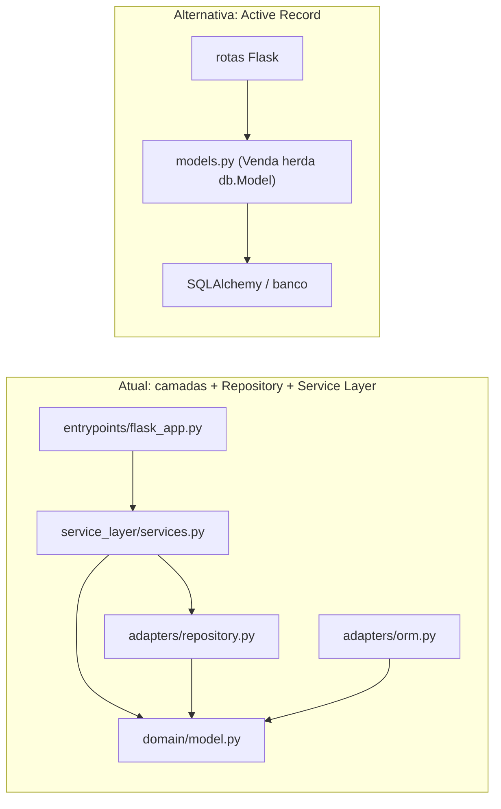

# Arquitetura do RocketTicket

Documento do checkpoint 1 da Fase 2 (tag `fase2-checkpoint-1`, prazo 22/10/2026 às 23h59 BRT).
Cada seção indica o responsável no comentário logo abaixo do título. Diagramas sempre em
Mermaid, com a fonte em texto neste arquivo. As decisões pontuais ficam nos ADRs em
[`adr/`](adr/).

## 1. Escopo

<!--
Responsável: Caio
O enunciado exige: o escopo do sistema.
-->

## 2. Requisitos

<!--
Responsável: Caio
O enunciado exige:
- pelo menos 3 atributos de qualidade, cada um escrito como cenário com fonte,
  estímulo, ambiente, artefato, resposta e medida;
- as restrições;
- os objetivos.
Os atributos definidos aqui são os mesmos avaliados nas seções 4 e 5.
-->

## 3. Arquitetura atual

<!--
Responsável: Lucas
O enunciado exige:
- os estilos e padrões arquiteturais usados;
- um diagrama de componentes em Mermaid com a direção das dependências;
- o mapeamento de cada componente para os arquivos em src/.
-->

## 4. Trade-offs

<!--
Responsável: Igor
O enunciado exige, para cada atributo de qualidade da seção 2:
- pelo menos 2 pontos de trade-off;
- pelo menos 1 risco.
-->

## 5. Arquitetura alternativa

<!--
Responsável: Miguel
O enunciado exige:
- uma alternativa concreta à arquitetura atual;
- uma tabela comparando as duas pelos mesmos atributos da seção 2;
- uma conclusão.
Concluir que a alternativa seria melhor é válido: avalia-se o argumento e a evidência.
-->

### 5.1 Alternativa: Flask com Active Record

Na alternativa, cada entidade é ela mesma o modelo do ORM: `Ticket`, `Venda` e
`Pedido` herdam de uma base declarativa do SQLAlchemy (ou do Flask-SQLAlchemy),
com as colunas declaradas na própria classe. Não existem `adapters/orm.py`,
`adapters/repository.py` nem `service_layer/services.py`: a rota do Flask busca
o objeto com uma query, chama o método de domínio e faz `commit` na sessão.



Exemplo do caso de uso `alterar_preco` da Venda nos dois estilos:

```python
# Atual: a rota chama o service, que usa o repositório e o domínio puro
venda = repo_vendas.get(venda_id)
venda.alterar_preco(novo_preco)
session.commit()

# Active Record: a rota fala direto com o modelo do ORM
venda = Venda.query.get(venda_id)        # Venda herda de db.Model
venda.alterar_preco(novo_preco)          # mesma regra, mas a classe agora conhece o banco
db.session.commit()
```

As regras de negócio continuariam nos métodos da entidade (`alterar_preco()`,
`cancelar()`, o teto de 110%), então a diferença não está em *onde* fica a regra,
e sim no que a entidade passa a carregar junto com ela.

### 5.2 Comparação pelos atributos de qualidade

Atributos comparados: testabilidade, modificabilidade, corretude das regras de negócio e simplicidade.

| Atributo | Arquitetura atual | Active Record | Quem ganha |
|---|---|---|---|
| **Testabilidade** | O domínio é puro (`model.py` não importa SQLAlchemy nem Flask) e os services são testados com Fakes, sem banco. Os testes unitários rodam sem criar nenhuma tabela. | Toda entidade depende do ORM; testar `Venda.alterar_preco()` exige o mapeamento carregado e, para os casos de uso, um banco (mesmo SQLite em memória). Não há onde encaixar um Fake sem mock de `Venda.query`. | Atual |
| **Modificabilidade** | Trocar o banco ou o framework web mexe só em `adapters/` ou `entrypoints/`. Em compensação, uma consulta ou caso de uso novo atravessa várias camadas: a consulta extra da Venda exigiu abstração, implementação real e Fake (ADR 0004). | Um caso de uso novo é uma rota e, no máximo, um método no modelo. Mas trocar o ORM ou testar sem banco obriga a mexer nas próprias entidades, porque elas *são* o ORM. | Depende: Active Record para mudanças pequenas e frequentes; atual para mudanças de infraestrutura |
| **Corretude das regras de negócio** | As invariantes só podem ser violadas passando pela raiz do agregado, e o service decide a ordem das operações (ex.: `criar_anuncio` chama `ticket.anunciar()` antes de criar a `Venda`). | As mesmas regras podem ficar nos métodos, mas qualquer rota pode alterar um atributo mapeado (`venda.preco = ...`) e fazer `commit` sem passar pela regra. Nada no desenho impede o atalho. | Atual |
| **Simplicidade** (custo de entender e mudar) | Mais arquivos e mais indireção: mapeamento imperativo separado (`orm.py`), um repositório por agregado, Fakes no `conftest.py` e services. | Menos código e menos conceitos; é o estilo da maioria dos tutoriais de Flask e o que um integrante novo entende mais rápido. | Active Record |

### 5.3 Conclusão

Para este domínio, **escolheríamos hoje a arquitetura atual**, com uma ressalva.

O que decide é que o RocketTicket é pequeno em volume de código, mas tem regras de
negócio que valem dinheiro e que cruzam agregados: o teto de 110% na revenda, o
ticket que não pode estar em dois anúncios ativos e o pedido que só confirma com
pagamento aprovado e ticket ainda anunciado. São exatamente as regras que o Active
Record deixa uma rota contornar, e são as que os testes unitários com Fakes
verificam rápido e sem banco. A camada de serviço também já mostrou valor ao
juntar dois agregados numa operação só, como no `criar_anuncio`.

A ressalva é o custo de indireção, que é real: cada consulta nova da Venda passa
por três lugares (ADR 0004), e o mapeamento imperativo em `orm.py` é código que o
Active Record dispensaria. Se o sistema fosse um CRUD sem regras entre agregados
(cadastro de eventos, por exemplo), o Active Record seria a escolha mais barata.
Uma solução híbrida faria sentido: manter domínio puro e services para Venda e
Pedido, onde estão as regras, e aceitar um estilo mais direto para partes que só
leem dados.

## 6. Evidências do repositório

<!--
Responsável: Guilherme
O enunciado exige: pelo menos 3 evidências tiradas do repositório, como hashes de
commit, tempos de execução da suíte e linhas de código.
-->
