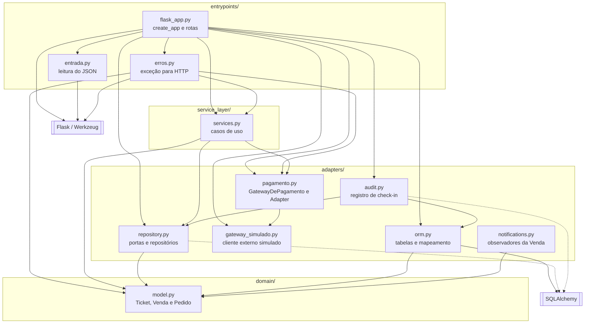
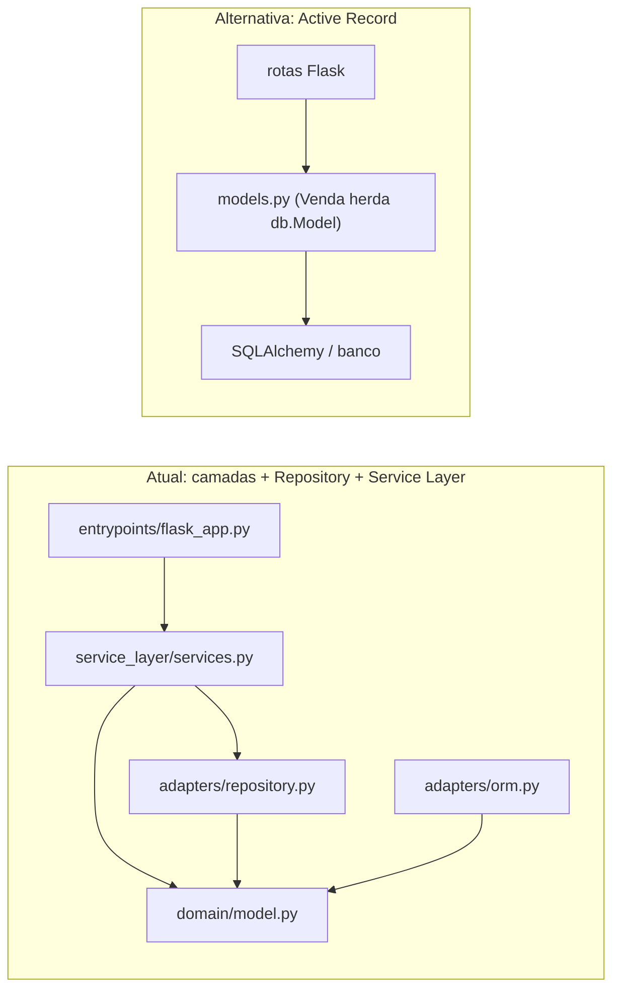

# Arquitetura do RocketTicket

## 1. Escopo

O RocketTicket é um sistema de revenda de ingressos entre pessoas. O organizador do evento
emite cada ticket já vendido ao primeiro dono, porque a emissão é a venda do organizador, e
faz o check-in na entrada. O dono que não vai ao evento anuncia o ticket com um preço que
nunca passa de 110% do valor original, a regra anti-cambismo do sistema, e pode alterar o
preço ou desfazer a última alteração enquanto o anúncio estiver ativo. O comprador abre um
pedido para um ticket anunciado, pelo preço do anúncio, e o pedido só é confirmado se o
gateway de pagamento aprovar a cobrança e o ticket ainda estiver anunciado. O sistema é uma
API HTTP em Flask, usada por esses três papéis: organizador, vendedor e comprador. Ficam
fora do escopo o cadastro de eventos e de usuários, que o sistema só referencia por id, a
autenticação e a integração com um meio de pagamento real: o gateway é simulado
(`adapters/gateway_simulado.py`).

## 2. Requisitos

### 2.1 Atributos de qualidade

Os quatro atributos são os mesmos comparados na seção 5, aqui em ordem de prioridade. A
corretude das regras de negócio vem primeiro porque essas regras valem dinheiro: o teto de
110% e a confirmação do pedido só com pagamento aprovado. A testabilidade vem em seguida
porque é ela que permite verificar essas regras a cada mudança. A modificabilidade e a
simplicidade disputam o mesmo espaço, e a seção 4 mostra onde uma cede à outra.

**1. Corretude das regras de negócio**

| Elemento | Cenário |
|---|---|
| Fonte | Um vendedor, pela API |
| Estímulo | Tenta anunciar um ticket ou alterar o preço do anúncio acima de 110% do valor original (por exemplo, 110,01 para um ticket de 100,00), ou tenta uma operação que o status do ticket não permite, como vender um ticket já usado |
| Ambiente | Operação normal, com os dados persistidos em banco |
| Artefato | Agregados Venda e Ticket (`domain/model.py`), chamados por `service_layer/services.py` |
| Resposta | A operação é recusada com uma `ErroDeDominio`, que a API devolve como HTTP 400. Nada é gravado e o agregado não muda |
| Medida da resposta | Toda combinação de status e operação do Ticket tem o resultado fixado em teste (as 16 células da matriz em `tests/unit/test_ticket_estados.py`). O teto é testado nas fronteiras 109,98, 109,985 e 109,99 para o valor original 99,99 (`tests/unit/test_venda.py`) e pela API (`test_preco_acima_do_limite_devolve_400`, em `tests/e2e/test_venda_api.py`) |

**2. Testabilidade**

| Elemento | Cenário |
|---|---|
| Fonte | Um integrante da equipe |
| Estímulo | Muda uma regra de um agregado ou um caso de uso e precisa verificar o resultado |
| Ambiente | Desenvolvimento local e CI (GitHub Actions) |
| Artefato | `domain/` e `service_layer/` |
| Resposta | A regra e o caso de uso são testados com os Fakes de `tests/conftest.py`, sem banco e sem montar a aplicação (`create_app`) |
| Medida da resposta | `pytest tests/unit` roda sem carregar o SQLAlchemy e em menos de 1 segundo, e `domain/model.py` importa só a biblioteca padrão |

**3. Modificabilidade**

| Elemento | Cenário |
|---|---|
| Fonte | A equipe |
| Estímulo | Precisa trocar ou acrescentar infraestrutura: outra persistência para o Ticket, auditoria do check-in, outro gateway de pagamento |
| Ambiente | Desenvolvimento, com a suíte existente verde |
| Artefato | `adapters/` e a composição em `entrypoints/flask_app.py` |
| Resposta | A mudança fica em `adapters/` e na composição de `create_app()`, sem mexer nas regras do domínio |
| Medida da resposta | Linhas de `domain/model.py` alteradas pelo commit da mudança (`git show --numstat`). O alvo é zero |

**4. Simplicidade (custo de entender e mudar)**

| Elemento | Cenário |
|---|---|
| Fonte | Um integrante que precisa acrescentar um caso de uso |
| Estímulo | Um caso de uso novo, exposto por um endpoint |
| Ambiente | Desenvolvimento |
| Artefato | `src/` e `tests/` |
| Resposta | O integrante segue o caminho dos outros casos de uso (rota, service, repositório, agregado) e cobre o caso de uso com testes |
| Medida da resposta | Número de arquivos de `src/` que o commit do caso de uso altera (`git show --stat`). Quanto menor, mais simples |

### 2.2 Restrições

- Python 3.12, a versão usada na CI (`.github/workflows/ci.yml`).
- Flask para a API HTTP, SQLAlchemy para a persistência e pytest para os testes, nas versões
  fixadas em `requirements.txt` (Flask 3.1.3, SQLAlchemy 2.0.54, pytest 9.1.1).
- Estrutura do Apêndice B do Cosmic Python: pacote `src/rocketicket/` com `domain/`,
  `adapters/`, `service_layer/` e `entrypoints/`, e testes em `tests/unit`,
  `tests/integration` e `tests/e2e`.
- O domínio não depende de framework: `domain/model.py` usa só a biblioteca padrão.
- Cada entrega só vale com a CI verde, e a suíte da Fase 1 continua passando depois de toda
  refatoração.
- Trabalho em grupo de cinco pessoas, com cada agregado sob a responsabilidade de um ou dois
  integrantes.

### 2.3 Objetivos

- Manter as regras de negócio nos agregados, onde só podem ser alteradas pela raiz.
- Testar as regras e os casos de uso sem banco, para que a suíte unitária seja rápida e rode
  a cada mudança.
- Poder trocar a infraestrutura (banco, gateway de pagamento, framework web) sem mexer no
  domínio.
- Permitir que cada integrante trabalhe no próprio agregado em paralelo, concentrando as
  edições compartilhadas nos pontos de composição (`flask_app.py` e `tests/conftest.py`).

## 3. Arquitetura atual

### 3.1 Estilos e padrões

- **Arquitetura em camadas.** Quatro pacotes: `entrypoints/` chama `service_layer/`, que
  orquestra `domain/`, com `adapters/` ao lado. As dependências apontam para o domínio:
  `domain/model.py` não importa nenhum outro módulo do projeto.
- **Ports and Adapters.** As portas são classes abstratas: `AbstractRepository` e as
  derivadas (`AbstractTicketRepository`, `AbstractVendaRepository`, `ConsultaVendaAtiva`,
  `AbstractHistoricoDePrecos`) e `GatewayDePagamento`. Os adaptadores são as implementações
  concretas (`SqlAlchemy*Repository`, `AdaptadorGatewayExterno`) e as falsas dos testes
  (`Fake*`, em `tests/conftest.py`). Na nossa versão, as portas ficam em `adapters/`, junto
  das implementações, e não no domínio nem na camada de serviço. Por isso `services.py`
  importa de `adapters/`, embora só classes abstratas. A exceção é `ObservadorVenda`, porta
  definida no próprio domínio.
- **Repository.** Um repositório por agregado, que só guarda e busca a raiz e nunca faz
  commit. A consulta extra da Venda tem abstração própria (ADR 0004), e o mapeamento entre
  classes e tabelas é imperativo (ADR 0001).
- **Service Layer.** `services.py` tem uma função por caso de uso, que recebe tipos
  primitivos, os repositórios e a sessão, orquestra os agregados e faz o commit.
- **Domínio rico com agregados.** Ticket, Venda e Pedido, com o Pagamento dentro do Pedido
  (ADR 0005). As invariantes ficam nos métodos da raiz, e os agregados só se referenciam por
  id. Os padrões GoF da Fase 2 (`gof.md`) vivem dentro dessa estrutura: State no Ticket,
  Memento e Observer na Venda, Decorator no repositório do Ticket e Adapter no gateway de
  pagamento.
- **Composição na entrada.** `create_app()` recebe a fábrica de sessões, a fábrica do
  repositório do Ticket e o gateway de pagamento, e monta as dependências de cada rota
  (injeção de dependência manual, assunto do DIP no `solid.md`).

### 3.2 Diagrama de componentes

Cada seta vai de quem importa para quem é importado, ou seja, na direção da dependência. A
seta tracejada indica uso em tempo de execução sem import: o repositório recebe a sessão
pronta.



Nenhuma seta sai de `model.py`. A camada de serviço depende do domínio e de dois módulos de
`adapters/`, mas só das classes abstratas deles. Como `pagamento.py` importa o cliente
simulado no topo, carregar `services.py` também carrega `gateway_simulado.py`.

### 3.3 Mapeamento para `src/`

| Componente | Arquivos | Responsabilidade |
|---|---|---|
| Domínio | `domain/model.py` | Agregados Ticket (com as classes de estado do State), Venda (com `PoliticaTetoPercentual`, `MementoPrecoVenda` e `ObservadorVenda`) e Pedido (com `Pagamento` e as regras de confirmação), e as exceções `ErroDeDominio` |
| Casos de uso | `service_layer/services.py` | `emitir_ticket`, `usar_ticket`, `criar_anuncio`, `alterar_preco`, `desfazer_alteracao_de_preco`, `criar_pedido`, `confirmar_pedido` e `cancelar_pedido`, e os erros `ErroDeServico` e `RecursoNaoEncontrado` |
| Repositórios | `adapters/repository.py` | Portas abstratas, repositórios SQLAlchemy, o Decorator de auditoria (`AuditedTicketRepository`) e o histórico de preços (caretaker do Memento) |
| Mapeamento ORM | `adapters/orm.py` | Tabelas, `map_imperatively` por agregado e `start_mappers()` |
| Pagamento | `adapters/pagamento.py`, `adapters/gateway_simulado.py` | Porta `GatewayDePagamento`, `AdaptadorGatewayExterno` e o cliente externo simulado |
| Auditoria de check-in | `adapters/audit.py` | Grava o `RegistroCheckIn` na tabela `checkins`, na transação do check-in |
| Notificações | `adapters/notifications.py` | Observador concreto da Venda (`NotificadorDeVenda`) e o canal `AbstractNotificacoes`. Hoje só os testes o usam (`tests/unit/test_venda_observer.py`): nenhuma rota registra o observador |
| API HTTP | `entrypoints/flask_app.py` | `create_app()`: sessão por requisição, composição das dependências e rotas dos três agregados |
| Entrada | `entrypoints/entrada.py` | `ler_json`, `ler_texto`, `ler_booleano` e `ler_decimal` |
| Erros HTTP | `entrypoints/erros.py` | `registrar_tratamento_de_erros()`: `ErroDeDominio` vira 400, `ErroDeServico` 409, `RecursoNaoEncontrado` 404 e `GatewayIndisponivel` 502 |

Fora de `src/`, os Fakes das portas ficam em `tests/conftest.py` (cinco classes, mais a
`FakeSession`).

## 4. Trade-offs

Para cada atributo da seção 2: como a arquitetura ajuda, onde cobra o preço, os pontos de
trade-off e um risco. Ponto de trade-off é uma decisão que favorece um atributo e prejudica
outro. Os números citados estão na seção 6.

### 4.1 Corretude das regras de negócio

**Ajuda.** As invariantes só mudam pela raiz do agregado, e o service decide a ordem das
operações: `criar_anuncio` chama `ticket.anunciar()` antes de criar a Venda e tira o
`valor_original` do ticket, não do JSON, e `criar_pedido` tira o valor do pedido do anúncio
ativo. Com o State (`gof.md`), a regra de cada status do Ticket fica numa classe só.

**Pontos de trade-off.**
- *Mapeamento imperativo (ADR 0001).* Mantém o domínio puro, o que favorece a
  testabilidade. Em compensação, o SQLAlchemy recria os objetos sem chamar `__init__`, e as
  invariantes validadas no construtor não são checadas de novo na leitura. Foi isso que
  expôs o bug do teto de 110%, corrigido com o arredondamento para baixo (ADR 0003).
- *Pagamento dentro do Pedido (ADR 0005).* A invariante do pedido é verificada inteira
  dentro de um agregado, a favor da corretude. Mas um caso de uso que parta do pagamento,
  como um retorno do gateway que só informa o id da transação, exige uma consulta nova ou
  rever a decisão, contra a modificabilidade.

**Risco.** O `confirmar_pedido` não vende o ticket nem conclui a venda: a docstring diz que
isso "fica para os eventos da Fase 2", tema que saiu do trabalho. Depois de um pedido
confirmado, o ticket continua ANUNCIADO, e um segundo pedido do mesmo ticket também é
confirmado. Isso foi conferido pela API: os pedidos `p1` e `p2` do ticket `t1` foram
aprovados um depois do outro. A regra cruza três agregados (Pedido, Ticket e Venda), e a
arquitetura atual não tem mecanismo para coordená-los numa operação só.

### 4.2 Testabilidade

**Ajuda.** O domínio puro e as portas abstratas permitem testar regras e casos de uso com
Fakes, e os testes unitários rodam sem carregar o SQLAlchemy. Na Fase 2, isso deu às
refatorações um teste de segurança barato: no State, a matriz de caracterização rodou contra
o código antigo, e os testes existentes passaram sem alteração (`gof.md`).

**Pontos de trade-off.**
- *Repository com Fake (ADR 0004).* Os testes unitários não precisam de banco. Mas cada
  consulta nova exige mudar três lugares (a abstração, a implementação real e o Fake), contra
  a simplicidade e a modificabilidade.
- *Dependências injetáveis em `create_app()` (DIP no `solid.md` e gateway do Adapter no
  `gof.md`).* Os testes trocam o repositório do Ticket e o gateway sem nenhuma condição
  especial no código. O custo é que `create_app()` ganhou parâmetros e o `flask_app.py`, que
  a refatoração SRP tinha reduzido para 98 linhas, está com 153.

**Risco.** O Fake pode divergir do repositório real. O `FakeVendaRepository` reimplementa em
Python o filtro da venda ativa, e se a regra mudar, só os testes de integração percebem,
porque eles não rodam contra o Fake (ADR 0004).

### 4.3 Modificabilidade

**Ajuda.** As mudanças de infraestrutura da Fase 2 ficaram fora do domínio: a SRP do
`flask_app.py`, a ISP do repositório da Venda, o DIP das rotas do Ticket e o Decorator de
auditoria não alteraram nenhuma linha de `domain/model.py`. O Adapter isolou o fornecedor
de pagamento: trocar de fornecedor é escrever outro adaptador.

**Pontos de trade-off.**
- *Camadas com service layer.* Uma troca de infraestrutura fica local, mas um caso de uso
  novo atravessa todas as camadas. O Memento, que acrescentou dois casos de uso e uma tabela,
  alterou cinco arquivos de `src/`: `orm.py`, `repository.py`, `model.py`, `flask_app.py` e
  `services.py`.
- *Portas em `adapters/`.* Há um pacote a menos para entender, a favor da simplicidade. Mas
  a camada de serviço passa a depender do pacote `adapters/`, e importar a porta de
  pagamento também carrega o cliente simulado, que mora no mesmo pacote.

**Risco.** O `create_app()` é o ponto em que todos os agregados se compõem. O `flask_app.py`
foi de 141 para 98 linhas com a SRP e voltou para 153, porque o DIP, o Decorator, o Memento
e o Adapter acrescentaram rotas e dependências. A própria seção SRP do `solid.md` registra,
em "O que não foi resolvido", que as rotas dos três agregados continuaram nessa função. Quanto mais o arquivo cresce, maior a
chance de conflito e de quebrar o endpoint de outro agregado.

### 4.4 Simplicidade (custo de entender e mudar)

**Ajuda.** Todo caso de uso segue o mesmo caminho (rota, service, repositório, agregado), e
cada um cabe numa função curta de `services.py`. Quem entende um caso de uso entende os
outros.

**Pontos de trade-off.**
- *Mapeamento imperativo (ADR 0001).* Mais um arquivo, e classe e tabela precisam ser
  mantidas em sincronia, a favor da testabilidade. O Memento mostrou o custo: os atributos do
  memento começam com `_`, e o `orm.py` precisou ligar cada coluna ao atributo à mão.
- *Padrões GoF.* Cada padrão trocou um trecho direto por indireção. O State acrescentou cinco
  classes e 57 linhas ao `model.py`, e o `anunciar()` padrão da classe base faz a transição,
  o que deixa um status novo ser anunciado se não sobrescrever o método (`gof.md`).

**Risco.** Dois padrões precisaram contornar o fato de o SQLAlchemy recriar os objetos sem
`__init__`: o State obtém o estado a partir do `status` (`_ESTADOS`), e o Observer cria a
lista de observadores sob demanda (`Venda._observadores()`). Quem acrescentar um atributo a
um agregado sem conhecer essa regra vai ver o erro só nos objetos lidos do banco, e os
testes unitários, que criam os agregados pelo `__init__`, não pegam esse caso.

## 5. Arquitetura alternativa

### 5.1 Alternativa: Flask com Active Record

Na alternativa, cada entidade é ela mesma o modelo do ORM: `Ticket`, `Venda` e
`Pedido` herdam de uma base declarativa do SQLAlchemy (ou do Flask-SQLAlchemy),
com as colunas declaradas na própria classe. Não existem `adapters/orm.py`,
`adapters/repository.py` nem `service_layer/services.py`: a rota do Flask busca
o objeto com uma query, chama o método de domínio e faz `commit` na sessão.



Exemplo do caso de uso `alterar_preco` da Venda nos dois estilos:

```python
# Atual: a rota chama o service, que usa o repositório e o domínio puro
venda = repo_vendas.get(venda_id)
venda.alterar_preco(novo_preco)
session.commit()

# Active Record: a rota fala direto com o modelo do ORM
venda = Venda.query.get(venda_id)        # Venda herda de db.Model
venda.alterar_preco(novo_preco)          # mesma regra, mas a classe agora conhece o banco
db.session.commit()
```

As regras de negócio continuariam nos métodos da entidade (`alterar_preco()`,
`cancelar()`, o teto de 110%), então a diferença não está em *onde* fica a regra,
e sim no que a entidade passa a carregar junto com ela.

### 5.2 Comparação pelos atributos de qualidade

Atributos comparados: testabilidade, modificabilidade, corretude das regras de negócio e simplicidade.

| Atributo | Arquitetura atual | Active Record | Quem ganha |
|---|---|---|---|
| **Testabilidade** | O domínio é puro (`model.py` não importa SQLAlchemy nem Flask) e os services são testados com Fakes, sem banco. Os testes unitários rodam sem criar nenhuma tabela. | Toda entidade depende do ORM; testar `Venda.alterar_preco()` exige o mapeamento carregado e, para os casos de uso, um banco (mesmo SQLite em memória). Não há onde encaixar um Fake sem mock de `Venda.query`. | Atual |
| **Modificabilidade** | Trocar o banco ou o framework web mexe só em `adapters/` ou `entrypoints/`. Em compensação, uma consulta ou caso de uso novo atravessa várias camadas: a consulta extra da Venda exigiu abstração, implementação real e Fake (ADR 0004). | Um caso de uso novo é uma rota e, no máximo, um método no modelo. Mas trocar o ORM ou testar sem banco obriga a mexer nas próprias entidades, porque elas *são* o ORM. | Depende: Active Record para mudanças pequenas e frequentes; atual para mudanças de infraestrutura |
| **Corretude das regras de negócio** | As invariantes só podem ser violadas passando pela raiz do agregado, e o service decide a ordem das operações (ex.: `criar_anuncio` chama `ticket.anunciar()` antes de criar a `Venda`). | As mesmas regras podem ficar nos métodos, mas qualquer rota pode alterar um atributo mapeado (`venda.preco = ...`) e fazer `commit` sem passar pela regra. Nada no desenho impede o atalho. | Atual |
| **Simplicidade** (custo de entender e mudar) | Mais arquivos e mais indireção: mapeamento imperativo separado (`orm.py`), um repositório por agregado, Fakes no `conftest.py` e services. | Menos código e menos conceitos; é o estilo da maioria dos tutoriais de Flask e o que um integrante novo entende mais rápido. | Active Record |

### 5.3 Conclusão

Para este domínio, **escolheríamos hoje a arquitetura atual**, com uma ressalva.

O que decide é que o RocketTicket é pequeno em volume de código, mas tem regras de
negócio que valem dinheiro e que cruzam agregados: o teto de 110% na revenda, o
ticket que não pode estar em dois anúncios ativos e o pedido que só confirma com
pagamento aprovado e ticket ainda anunciado. São exatamente as regras que o Active
Record deixa uma rota contornar, e são as que os testes unitários com Fakes
verificam rápido e sem banco. A camada de serviço também já mostrou valor ao
juntar dois agregados numa operação só, como no `criar_anuncio`.

A ressalva é o custo de indireção, que é real: cada consulta nova da Venda passa
por três lugares (ADR 0004), e o mapeamento imperativo em `orm.py` é código que o
Active Record dispensaria. Se o sistema fosse um CRUD sem regras entre agregados
(cadastro de eventos, por exemplo), o Active Record seria a escolha mais barata.
Uma solução híbrida faria sentido: manter domínio puro e services para Venda e
Pedido, onde estão as regras, e aceitar um estilo mais direto para partes que só
leem dados.

## 6. Evidências do repositório

Medições feitas em 16/11/2026 sobre o commit `d7baf0b` (mesmo código de `71c165f`, a tag `fase2-checkpoint-3`), com Python 3.12.3. Cada evidência traz o comando e a saída. Os comandos do pytest rodaram com `-p no:cacheprovider`.

### 6.1 Os testes unitários são mais rápidos e não carregam o banco

Cada camada da suíte rodou três vezes:

```text
$ pytest tests/unit -q          223 passed in 0.91s | 0.85s | 0.81s
$ pytest tests/integration -q    50 passed in 1.21s | 0.97s | 0.96s
$ pytest tests/e2e -q            63 passed in 1.45s | 1.42s | 1.44s
$ pytest tests -q               336 passed in 2.74s | 2.71s | 2.69s
```

Dividindo o tempo da segunda rodada de cada camada pelo número de testes, dá cerca de 3,8 ms
por teste unitário (0,85 s ÷ 223) e cerca de 23 ms por teste e2e (1,44 s ÷ 63). As cinco etapas mais
lentas da suíte (`pytest tests --durations=5`) são todas de testes e2e. Os testes unitários
também não carregam o SQLAlchemy:

```text
$ cd tests && python -c "import sys, pytest; pytest.main(['unit', '-q', '-p', 'no:cacheprovider']); print('sqlalchemy' in sys.modules)"
223 passed in 0.67s
False
```

Isso confirma a medida do cenário de testabilidade (seção 2): menos de 1 segundo e nenhum
banco. O Flask é carregado, por causa dos testes de `entrypoints/entrada.py`.

### 6.2 O código de infraestrutura já é maior que o domínio

```text
$ wc -l src/rocketicket/domain/model.py src/rocketicket/adapters/*.py
  534 src/rocketicket/domain/model.py
   16 src/rocketicket/adapters/audit.py
   49 src/rocketicket/adapters/gateway_simulado.py
   55 src/rocketicket/adapters/notifications.py
  154 src/rocketicket/adapters/orm.py
   68 src/rocketicket/adapters/pagamento.py
  236 src/rocketicket/adapters/repository.py
```

Os seis arquivos de `adapters/` somam 578 linhas, contra 534 do domínio. Só o mapeamento
(`orm.py`, 154 linhas) repete em tabelas a estrutura das classes do domínio, que é o custo
de simplicidade registrado no ADR 0001. Os cinco Fakes ficam em `tests/conftest.py`, que tem
166 linhas.

### 6.3 A suíte cresceu a cada checkpoint

Contagem rodando `pytest tests` numa cópia limpa de cada tag (`git archive`):

| Tag | Commit | Resultado |
|---|---|---|
| `fase2-checkpoint-1` | `fbf6358` | 180 passed |
| `fase2-checkpoint-2` | `8eadcc7` | 235 passed |
| `fase2-checkpoint-3` | `71c165f` | 336 passed |

Foram 156 testes a mais na Fase 2, e a suíte inteira passou em cada uma das três tags.

### 6.4 Refatorações e padrões: quem tocou o domínio

Para cada commit de código da Fase 2, os arquivos de `src/` alterados e as linhas de
`domain/model.py` (`git show --numstat --format= <hash> -- src`):

| Commit | Autor | Mudança | Arquivos de `src/` | Linhas de `model.py` (+/−) |
|---|---|---|---|---|
| `50077c9` | Guilherme | OCP na confirmação do Pedido | 1 | +49 / −9 |
| `576af01` | Igor | SRP na Venda (`PoliticaTetoPercentual`) | 2 | +28 / −31 |
| `17af148` | Lucas | SRP no `flask_app.py` | 3 | 0 |
| `da058ef` | Miguel | ISP na consulta da venda ativa | 2 | 0 |
| `ed6a19a` | Caio | DIP nas rotas do Ticket | 1 | 0 |
| `a4f0292` | Lucas | State no Ticket | 1 | +97 / −40 |
| `7435b36` | Igor | Memento no preço do anúncio | 5 | +34 / −0 |
| `b48915a` | Caio | Decorator na auditoria de check-in | 5 | 0 |
| `32cf2cf` | Miguel | Observer na Venda | 2 | +41 / −3 |
| `e10e80b` | Guilherme | Adapter no gateway de pagamento | 6 | +10 / −0 |

As quatro mudanças de infraestrutura (`17af148`, `da058ef`, `ed6a19a` e `b48915a`) não
tocaram o domínio, como pede o cenário de modificabilidade. As mudanças de regra (OCP, SRP
da Venda, State e Observer) ficaram concentradas no `model.py`, em um ou dois arquivos. As
duas que acrescentaram funcionalidade atravessando as camadas, o Memento (dois casos de uso
e uma tabela) e o Adapter (cobrança no gateway dentro do `confirmar_pedido`), alteraram
cinco e seis arquivos de `src/`: é a medida do cenário de simplicidade. No
Adapter, as 10 linhas do `model.py` são o método `Pedido.exigir_cobranca_pendente()`, uma
regra nova (não cobrar de novo um pedido já processado), e não infraestrutura vazando para
o domínio.
