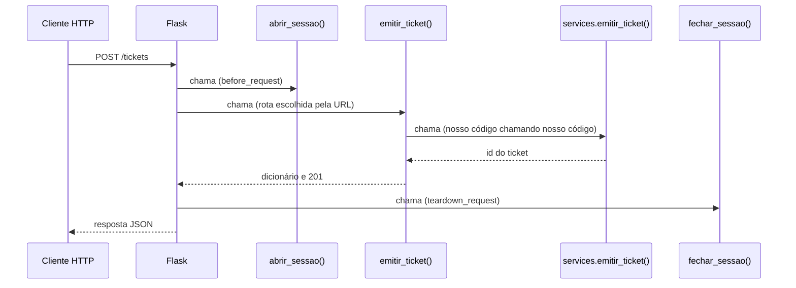

# Frameworks no RocketTicket

O sistema usa três frameworks: Flask na API HTTP, SQLAlchemy na persistência e pytest nos
testes. Este documento mostra o papel de cada um, onde eles chamam o nosso código, que
padrões de projeto usam por dentro e o que mudaria com o Django. As referências a código
são do commit `f6b59e4` da `main`.

## 1. Papel de cada framework

| Framework | Papel | Camada | Onde aparece |
|---|---|---|---|
| **Flask** (com o Werkzeug) | Recebe a requisição HTTP, escolhe a função pela URL, devolve a resposta em JSON e traduz exceções em códigos HTTP | `entrypoints/` | `flask_app.py` (`create_app()` e as 8 rotas), `entrada.py` (`request`, `abort`) e `erros.py` (`errorhandler`, `HTTPException`) |
| **SQLAlchemy** | Liga as classes do domínio às tabelas, gera o SQL e controla a transação pela `Session` | `adapters/` | `orm.py` (tabelas e `map_imperatively`), `audit.py` (insert na tabela `checkins`) e os `SqlAlchemy*Repository`, que recebem a sessão pronta |
| **pytest** | Encontra e roda os testes, monta o ambiente de cada um pelas fixtures e varia entradas com `parametrize` | `tests/` | `tests/conftest.py` (fixtures `in_memory_db`, `session`, `client` e os Fakes), `tests/pytest.ini` e os 28 usos de `@pytest.mark.parametrize` |

### Por que o domínio não depende deles

`domain/model.py` importa só a biblioteca padrão:

```python
from decimal import Decimal, ROUND_DOWN
from enum import Enum
from typing import Iterable, Protocol
```

Três decisões mantêm essa separação:

- **Flask fica na borda.** As rotas leem o JSON com `entrada.py`, chamam um service com tipos
  primitivos e devolvem um dicionário. O domínio lança `ErroDeDominio`, e é o `erros.py` que
  a transforma em HTTP 400. Nenhuma classe do domínio sabe o que é uma requisição.
- **O SQLAlchemy mapeia o domínio de fora.** O mapeamento imperativo (ADR 0001) declara as
  tabelas em `orm.py` e só liga as classes a elas em `start_mappers()`. Nem `services.py` nem
  `repository.py` importam o SQLAlchemy: eles recebem a sessão como parâmetro. A seção 6.1 do
  `arquitetura.md` mostra o efeito: `pytest tests/unit` roda sem carregar o SQLAlchemy.
- **O pytest só existe em `tests/`.** Nenhum arquivo de `src/` importa o pytest, e os testes
  unitários usam Fakes no lugar dos adaptadores reais.

## 2. Inversão de controle

A diferença entre **framework** e **biblioteca** está em quem chama quem. Com uma
biblioteca, o nosso código decide quando chamar: `PoliticaTetoPercentual` chama
`Decimal.quantize()` no momento em que precisa do teto, e o `test_orm.py` chama
`sqlalchemy.text()` para conferir o banco. Com um framework, nós entregamos funções e
classes, e é ele que decide quando executá-las ("não nos chame, nós chamamos você"). Há três
pontos assim no RocketTicket.

### 2.1 Rotas e ganchos do Flask

Em `flask_app.py`, nenhuma linha chama `emitir_ticket()` ou `fechar_sessao()`. As funções só
são **registradas**:

```python
@app.before_request
def abrir_sessao():
    g.session = session_factory()

@app.teardown_request
def fechar_sessao(exc):
    ...

@app.post("/tickets")
def emitir_ticket():
    ...
```

Quando chega uma requisição, o Flask decide a ordem: abre a sessão, escolhe a rota pela URL
e pelo método, chama a função, converte o retorno em JSON e, no fim, fecha a sessão, mesmo
se houve exceção. Nos erros acontece o mesmo: `registrar_tratamento_de_erros()` só registra
cinco tratadores, e o Flask escolhe o da classe mais específica. Por isso
`RecursoNaoEncontrado` responde 404, e não o 409 da sua base `ErroDeServico`.



Tudo o que aparece como "chama" partindo do Flask é inversão de controle. Só a seta de
`emitir_ticket()` para o service é uma chamada nossa.

### 2.2 Fixtures do pytest

Os testes não criam o banco nem o app. Eles só **declaram** o que precisam no parâmetro:

```python
def test_emitir_devolve_201_e_o_id(self, client):
```

O pytest lê o nome `client`, procura a fixture em `tests/conftest.py`, descobre que ela
depende de `in_memory_db` e monta a cadeia na ordem certa: cria o banco SQLite em memória,
cria o app com `create_app()`, entrega o `test_client()` ao teste e, depois do `yield`, roda
o `clear_mappers()`. Quem decide quando rodar cada teste e cada etapa de preparação e
limpeza é o pytest. O mesmo vale para a coleta: ele encontra os testes pela convenção de
nomes (`test_*.py`, `Test*`, `test_*`), sem nenhuma lista feita por nós.

### 2.3 Mapeamento do SQLAlchemy

Em `orm.py`, o `map_imperatively()` entrega as nossas classes ao SQLAlchemy, e a partir daí
ele decide duas coisas:

- **Quando instanciar os objetos.** Ao ler do banco, o SQLAlchemy cria o `Ticket`, a `Venda`
  e o `Pedido` sem chamar o `__init__`. Isso obrigou dois padrões da Fase 2 a se adaptarem:
  o State obtém o estado a partir do `status` (`_ESTADOS` e a propriedade `_estado`), e o
  Observer cria a lista de observadores sob demanda (`Venda._observadores()`).
- **Quando gravar.** Os services só chamam `session.commit()`. É o SQLAlchemy que descobre
  o que mudou e emite os `INSERT` e `UPDATE` (seção 3.2).

## 3. Padrões internos dos frameworks

Os seis padrões abaixo são usados pelos frameworks por dentro e aparecem no nosso código.
Proxy é um padrão do GoF; Data Mapper, Unit of Work, Identity Map e Front Controller são do
catálogo de Fowler (*Patterns of Enterprise Application Architecture*); Dependency
Injection é a forma de inversão de controle das fixtures.

| Padrão | Framework | Onde aparece no nosso código |
|---|---|---|
| Data Mapper | SQLAlchemy | `orm.py`, `map_imperatively()` |
| Unit of Work | SQLAlchemy | a `Session` recebida pelos services, `session.commit()` |
| Identity Map | SQLAlchemy | `session.get()` nos repositórios e o `expunge_all()` do `test_orm.py` |
| Proxy (GoF) | Flask / Werkzeug | o objeto `g` em `flask_app.py` |
| Front Controller | Flask | `create_app()` e o registro das 8 rotas |
| Dependency Injection | pytest | as fixtures de `tests/conftest.py` |

### 3.1 Data Mapper (SQLAlchemy)

Um objeto separado transfere os dados entre o objeto do domínio e a tabela, e os dois não se
conhecem. É exatamente o `map_imperatively()`: `model.Ticket` não sabe da tabela `tickets`,
e é o mapper criado em `_mapear_ticket()` que converte de um para o outro. O oposto seria
o Active Record, em que a classe é a própria tabela (seção 4 e seção 5 do `arquitetura.md`).
No Pedido, o mapper também leva o `Pagamento` junto pelo `relationship(...,
cascade="all, delete-orphan")`, o que sustenta o ADR 0005 sem nenhuma linha de banco no
domínio.

### 3.2 Unit of Work (SQLAlchemy)

A `Session` registra os objetos novos e alterados durante a operação e grava tudo de uma vez
no `commit()`, numa transação só. No nosso código, isso aparece no `alterar_preco` de
`services.py`: o service lê a venda, altera o preço e faz o commit, **sem chamar
`repo.add()` de novo**. A sessão percebeu sozinha que a venda mudou. Conferimos com o próprio
mapeamento: depois de `ticket.anunciar()` num ticket lido do banco, o ticket aparece em
`session.dirty`, e o `commit()` grava `anunciado` na coluna `status`.

O Decorator de auditoria do Caio depende desse padrão: o `SqlAlchemyCheckInAudit` insere o
registro na mesma sessão do check-in, então o registro e a mudança do ticket entram juntos ou
não entram (`audit.py`).

### 3.3 Identity Map (SQLAlchemy)

Dentro de uma sessão, cada linha do banco corresponde a um único objeto: dois `get()` do
mesmo id devolvem o **mesmo** objeto, sem ir de novo ao banco. Conferimos com o
`SqlAlchemyTicketRepository`: `repo.get("t1") is repo.get("t1")` é `True`. O padrão explica
uma regra dos nossos testes de integração: o helper `salvar()` de `test_orm.py` faz
`commit()` e `expunge_all()` antes de ler, porque sem isso o `get()` devolveria o próprio
objeto da memória, e o teste passaria mesmo com o mapeamento errado.

### 3.4 Proxy (Flask / Werkzeug)

O `g` que as rotas usam para guardar a sessão (`g.session`, 23 usos em `flask_app.py`) não é
um objeto comum: é um `werkzeug.local.LocalProxy`. Ele tem a mesma interface de um objeto
qualquer, mas repassa cada acesso ao objeto do contexto da requisição atual. É o Proxy do
GoF: um substituto que controla o acesso ao objeto real. Por causa dele, duas requisições
simultâneas usam o mesmo nome `g.session` e cada uma enxerga a sua própria sessão.

### 3.5 Front Controller (Flask)

Uma aplicação Flask é um único ponto de entrada que recebe todas as requisições e despacha
cada uma para a função certa. No RocketTicket, `create_app()` monta esse controlador e
registra as 8 rotas na tabela de URLs do app (`app.url_map`): `POST /tickets`,
`POST /tickets/<ticket_id>/check-in`, `POST /anuncios`, `PUT /anuncios/<venda_id>/preco`,
`POST /anuncios/<venda_id>/preco/desfazimento`, `POST /pedidos`,
`POST /pedidos/<pedido_id>/confirmacao` e `POST /pedidos/<pedido_id>/cancelamento`. Os
ganchos comuns a todas, como abrir e fechar a sessão e traduzir erros, ficam nesse ponto
único, e não repetidos em cada rota.

### 3.6 Dependency Injection (pytest)

As fixtures são injeção de dependência: o teste declara o que precisa, e o pytest constrói e
entrega. A fixture `client` recebe `in_memory_db` do mesmo jeito, e a `session` também, o
que forma um grafo de dependências resolvido pelo pytest. É o mesmo princípio que levamos
para o `create_app()` na Fase 2: com o DIP do Caio (`solid.md`), o
`test_ticket_repository_injection.py` injeta outro repositório do Ticket no app, e com o
Adapter do Guilherme (`gof.md`), o `test_pedido_api.py` injeta outro gateway de pagamento.

## 4. O que mudaria com Django

O Django é um framework full-stack: traz ORM, roteamento, painel administrativo, migrações e
executor de testes integrados, com convenções próprias para tudo. Para o RocketTicket, as
mudanças seriam estas:

| Aspecto | Hoje (Flask + SQLAlchemy + pytest) | Com Django |
|---|---|---|
| **Modelo do domínio** | Classes Python puras em `model.py`, mapeadas de fora (Data Mapper) | Classes herdando de `models.Model`, com os campos declarados nelas (Active Record). O domínio passaria a depender do framework |
| **Persistência** | `orm.py`, repositórios e Fakes | Desapareceriam: o próprio modelo faz `Venda.objects.get(...)` e `venda.save()`. Menos código, mas qualquer view pode alterar `venda.preco` e salvar sem passar pela regra |
| **Estrutura** | Pacotes do Apêndice B (`domain/`, `adapters/`, `service_layer/`, `entrypoints/`) | Um projeto com apps, como `tickets/`, `vendas/` e `pedidos/`, cada um com `models.py`, `views.py`, `urls.py` e `tests.py` |
| **Esquema do banco** | `metadata.create_all()`, sem histórico | Migrações geradas a partir dos modelos (`makemigrations`), versionadas no repositório |
| **API e validação** | `entrada.py` valida e converte o JSON à mão (`ler_decimal`, `ler_texto`) | Com o Django REST Framework, serializers fariam essa validação, e ViewSets gerariam as rotas |
| **Sessão por requisição** | `before_request` e `teardown_request` em `create_app()` | O Django gerencia a conexão sozinho, e `ATOMIC_REQUESTS` põe cada requisição numa transação |
| **Composição e configuração** | `create_app()` recebe a fábrica de sessões, o repositório e o gateway como parâmetros | Configuração global em `settings.py`, lida de qualquer lugar. A injeção do DIP ficaria mais difícil |
| **Testes** | Unitários sem banco, com Fakes; integração com SQLite em memória | O `TestCase` do Django cria um banco de teste e envolve cada teste numa transação. Como os modelos são o ORM, quase todo teste de regra passaria a precisar de banco |
| **Observer** | `ObservadorVenda`, implementado à mão no domínio | Os *signals* do Django (`post_save`) fariam esse papel, mas presos ao ciclo de gravação do ORM, e não às regras da Venda |
| **Painel administrativo** | Não existe | Viria pronto. O cadastro de eventos e de usuários, hoje fora do escopo (seção 1 do `arquitetura.md`), sairia quase de graça |

O Django resolveria mais rápido o que hoje é encanamento, como a persistência, a validação
da entrada e o painel administrativo. O preço é o mesmo da alternativa Active Record
analisada na seção 5 do `arquitetura.md`: o domínio deixaria de ser puro, os testes de
regra passariam a depender do banco, e a garantia de que o teto de 110% e as invariantes
só mudam pela raiz do agregado ficaria a cargo da disciplina da equipe, e não do desenho.
Usar o Django mantendo o domínio puro e os repositórios é possível, mas significaria
trabalhar contra as convenções do framework e abrir mão do que ele traz de mais útil.