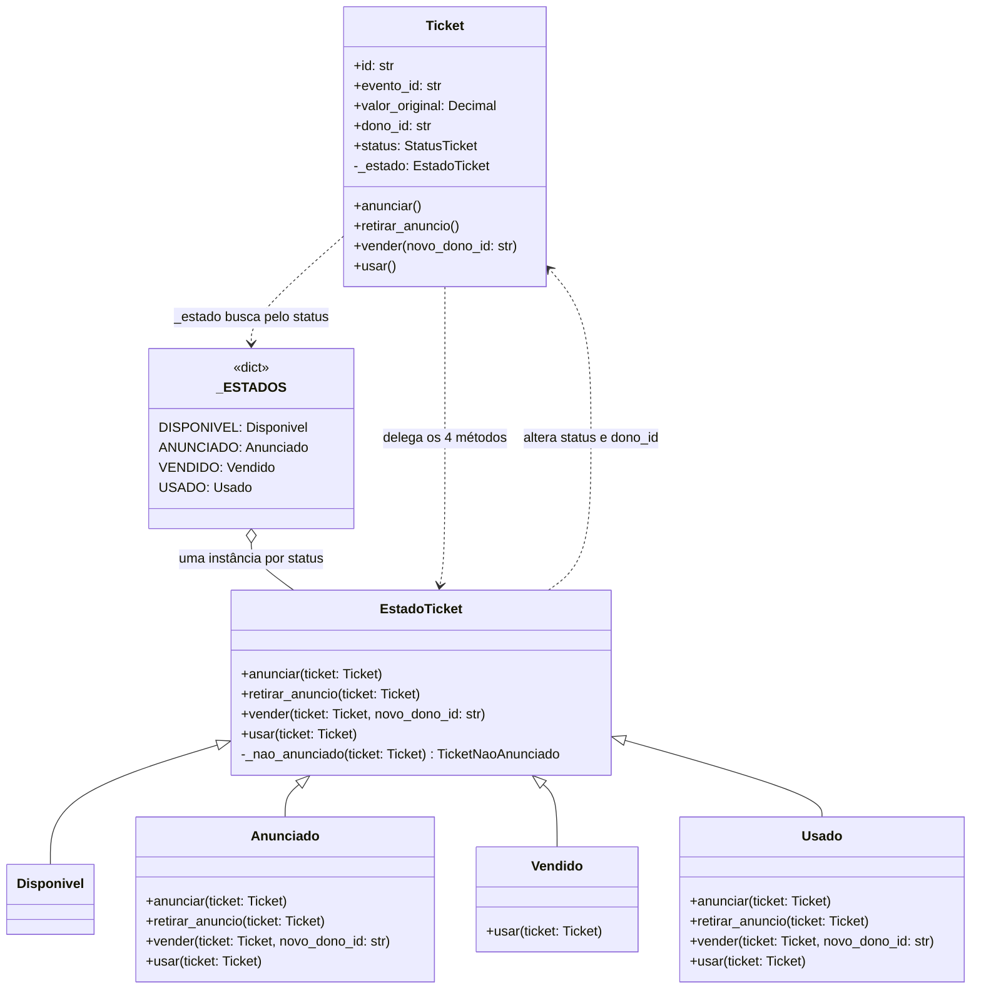

# Padrões GoF no RocketTicket

## Lucas — State

### Nome e categoria

**State**, padrão comportamental do GoF. A intenção, nos termos do catálogo, é permitir que
um objeto altere o seu comportamento quando o seu estado interno muda, como se tivesse
mudado de classe. No RocketTicket, o objeto é o `Ticket`, e o estado interno é o `status`.

### Contexto e problema

O `Ticket` tem quatro status (`DISPONIVEL`, `ANUNCIADO`, `VENDIDO` e `USADO`) e quatro
métodos cujo resultado depende deles: `anunciar()`, `retirar_anuncio()`, `vender()` e
`usar()`. Antes do State, cada método decidia o que era permitido com uma cadeia de `if`
sobre `self.status`: eram 9 comparações de status nos quatro métodos, mais a regra do
próprio dono em `vender()`. Este é o `usar()` em `513bc0a`, o commit anterior a `a4f0292`
(docstring omitida):

```python
def usar(self) -> None:
    if self.status is StatusTicket.USADO:
        raise TicketJaUsado(f"ticket {self.id} já foi usado")
    if self.status is StatusTicket.ANUNCIADO:
        raise TicketAnunciado(
            f"ticket {self.id} está anunciado e não pode ser usado"
        )
    if self.status is not StatusTicket.VENDIDO:
        raise TicketNaoVendido(
            f"ticket {self.id} não foi vendido (status: {self.status.value})"
        )
    self.status = StatusTicket.USADO
```

O comportamento de cada status ficava espalhado pelos quatro métodos, misturado ao de todos
os outros. Um estado novo, como reintroduzir `DISPONIVEL` como o status da venda primária,
obrigava a editar os quatro. A ordem das checagens também importava: em `vender()`, `USADO`
precisava ser testado antes de "não anunciado", porque um ticket usado satisfaz as duas
condições, e é a ordem que decide qual exceção sai. O próprio `DISPONIVEL`, que nenhum
caminho alcança, tinha um comportamento que ninguém escreveu de propósito: era o que sobrava
depois de passar por todos os `if`.

Depois de `a4f0292`, o Ticket só delega, e cada status responde por si (as partes omitidas
estão marcadas com `# (...)`):

```python
class Ticket:
    # (...)
    @property
    def _estado(self) -> EstadoTicket:
        return _ESTADOS[self.status]

    def usar(self) -> None:
        self._estado.usar(self)


class Anunciado(EstadoTicket):
    # (...)
    def usar(self, ticket: "Ticket") -> None:
        raise TicketAnunciado(f"ticket {ticket.id} está anunciado e não pode ser usado")


class Vendido(EstadoTicket):
    def usar(self, ticket: "Ticket") -> None:
        ticket.status = StatusTicket.USADO
```

### Alternativa considerada

- **Manter os `if`.** É o código mais curto e deixa o fluxo de cada método num lugar só.
  Foi descartado pelo problema acima: cada status novo, ou cada mudança na regra de um
  status, continuaria passando pelos quatro métodos e pela ordem das checagens.
- **Uma tabela de transições** `(status, método) -> status de destino`, como
  `{(VENDIDO, "anunciar"): ANUNCIADO, ...}`. Ela descreve bem as 5 transições válidas da
  matriz de caracterização, mas não basta para as outras 11 posições, que são recusas: cada
  par inválido lança uma exceção diferente, com mensagem própria. São 5 classes de exceção e
  9 mensagens distintas, e só a `TicketJaUsado` tem uma mensagem por método. Além disso, o
  `vender()` tem uma regra que não depende só do status, a de não vender ao próprio dono
  (`CompraDoProprioTicket`), checada depois do status. A transição do `vender()` também
  troca o dono, o que uma tabela de status não representa. Para cobrir tudo isso, cada célula
  teria de guardar uma função, e a tabela viraria o State sem nomes.
- **Uma subclasse de `Ticket` por estado.** Descartada porque o ORM mapeia uma única classe:
  o `orm.py` faz `map_imperatively(model.Ticket, tickets)`. Com subclasses, cada transição
  exigiria trocar a classe do objeto, e o mapeamento teria de virar herança polimórfica, com
  o `status` como discriminador. Isso levaria para o `adapters/orm.py` uma decisão de
  comportamento do domínio. No State, a classe mapeada continua uma só, e o que muda é o
  objeto para o qual ela delega.

### Participantes (classes reais)

| Papel no GoF | No código (`domain/model.py`) | O que faz |
|---|---|---|
| Context | `Ticket` | guarda os dados e o `status`; `anunciar()`, `retirar_anuncio()`, `vender()` e `usar()` só delegam ao estado atual, passando o próprio ticket |
| State | `EstadoTicket` | declara os quatro métodos, todos recebendo o ticket, com o comportamento padrão: `anunciar()` passa para `ANUNCIADO`, `retirar_anuncio()` e `vender()` lançam `TicketNaoAnunciado`, e `usar()` lança `TicketNaoVendido` |
| ConcreteState | `Disponivel`, `Anunciado`, `Vendido` e `Usado` | cada um sobrescreve só o que muda no seu status: `Disponivel` não sobrescreve nada, `Vendido` sobrescreve só `usar()`, e `Anunciado` e `Usado` sobrescrevem os quatro |
| (escolha do estado) | `_ESTADOS` e a propriedade `Ticket._estado` | `_ESTADOS` liga cada `StatusTicket` à instância do seu estado, e `_estado` devolve `_ESTADOS[self.status]` |

**Por que o estado é derivado do `status`.** No GoF, o Context guarda uma referência ao
objeto State e a troca a cada transição. Aqui o Ticket não guarda o estado: o `status` é a
única fonte de verdade, e o `_estado` é recalculado a cada chamada. O motivo é o mapeamento
imperativo (ADR 0001): a coluna persistida é `status`, e o SQLAlchemy recria o Ticket lido do
banco sem chamar `__init__`. Um atributo de estado criado no `__init__` não existiria nos
tickets carregados, e recriá-lo exigiria um gancho do ORM, que o `model.py` não pode conhecer.

Esse desenho tem duas consequências:

- **Quem faz a transição é o ConcreteState.** `Anunciado.vender()` troca `ticket.dono_id` e
  `ticket.status`. Como o estado vem do status, mudar o status já troca o estado.
- **Os estados são compartilhados.** Eles não guardam nada e recebem o ticket como
  parâmetro, então uma instância de cada, no `_ESTADOS`, serve para todos os tickets. O GoF
  prevê esse compartilhamento quando o estado não tem dados próprios.

### Diagrama de classes (Mermaid)



### Teste

O `tests/unit/test_ticket_estados.py` é a matriz de caracterização. Para cada um dos 16 pares
(4 status × 4 métodos), ele monta o ticket naquele status, chama o método e confere a
transição (status e dono finais) ou a exceção, com a mensagem exata. Nas recusas, confere
também que o ticket não mudou. Dos 16 pares, 5 são transições e 11 são recusas. O arquivo
tem 21 testes:

| Testes | O que conferem |
|---|---|
| 16 `test_matriz` | os 16 pares, um por status em cada método (`TestAnunciar`, `TestRetirarAnuncio`, `TestVender` e `TestUsar`) |
| 1 `test_cobre_todos_os_status_em_cada_metodo` | falha se algum status ficar fora da matriz em algum método |
| 1 `test_vender_ao_proprio_dono_falha` | a `CompraDoProprioTicket`, com a mensagem exata, num ticket anunciado |
| 3 `test_status_tem_prioridade_sobre_a_regra_do_proprio_dono` | fora de `ANUNCIADO`, a checagem de status vem antes da regra do próprio dono |

Os tickets são montados pela API do domínio, menos o de `DISPONIVEL`: como nenhum caminho
alcança esse status, o helper `disponivel()` o atribui na mão, só para fixar o comportamento
que o código antigo tinha.

A matriz foi escrita e rodada antes da refatoração, contra o código com os `if`. Isso pode ser
conferido, porque o arquivo de `a4f0292` passa também contra o `model.py` de `a4f0292~1`. Os
comandos abaixo criam uma cópia do repositório nesse commit, trazem o teste de `a4f0292` e
rodam só ele, com o resultado `21 passed`:

```sh
git worktree add ../antes-do-state a4f0292~1
git -C ../antes-do-state checkout a4f0292 -- tests/unit/test_ticket_estados.py
pytest ../antes-do-state/tests/unit/test_ticket_estados.py
git worktree remove --force ../antes-do-state
```

A suíte existente passou sem nenhuma alteração. O `git show a4f0292 --stat` mostra que o
único arquivo de teste do commit é o novo:

```text
$ git show a4f0292 --stat
 DECISIONS.md                      |  46 +++++++
 docs/gof.md                       | 256 ++++++++++++++++++++++++++++++++++++++
 src/rocketicket/domain/model.py   | 137 ++++++++++++++------
 tests/unit/test_ticket_estados.py | 192 ++++++++++++++++++++++++++++
 4 files changed, 591 insertions(+), 40 deletions(-)

$ pytest tests    # em a4f0292^, antes do State
235 passed
$ pytest tests    # em a4f0292, com o State
256 passed
```

Os 256 são os 235 testes que já existiam, sem nenhuma mudança, mais os 21 da matriz.

### Custo

- **Mais classes e uma indireção para ler o fluxo.** São cinco classes e um dicionário a
  mais, e o `model.py` cresceu 57 linhas no commit (+97/−40). Para saber o que
  `ticket.vender()` faz, não basta ler o `Ticket`: é preciso abrir o `EstadoTicket.vender()`,
  que vale para dois status, e as versões de `Anunciado` e de `Usado`.
- **O estado vive separado do Ticket.** Os ConcreteStates escrevem `ticket.status` e
  `ticket.dono_id` de fora da classe, então as regras que mudam os dados do Ticket deixaram
  de morar só nele e se dividem entre cinco classes.
- **`DISPONIVEL` ganhou uma classe mesmo sendo inalcançável.** `Disponivel` existe para o
  `_ESTADOS` cobrir todos os status e para preservar o comportamento que o código antigo tinha
  para esse status.
- **O `anunciar()` padrão faz a transição.** Como no código antigo, um status que não
  sobrescreva `anunciar()` pode ser anunciado. Um status novo também precisa entrar no
  `_ESTADOS`, senão o `_estado` lança `KeyError`. O
  `test_cobre_todos_os_status_em_cada_metodo` obriga a pôr o status novo na matriz, onde as
  duas falhas aparecem.

**Por que compensa.** Um estado novo é uma classe nova e uma linha no `_ESTADOS`, sem tocar
nos métodos do Ticket, e mudar a regra de um status mexe só na classe dele. No exemplo do
contexto, reintroduzir `DISPONIVEL` como venda primária passa a ser editar a `Disponivel`, e
não os quatro métodos e a ordem de nove checagens. O ganho vale para estados novos, não para
operações novas: um método novo no Ticket, como um `reservar()`, ainda exige um método no
`EstadoTicket` e uma decisão em cada estado.

## Caio — Decorator

### Nome e categoria

<!--
Responsável: Caio
O enunciado exige: o nome do padrão e a sua categoria no GoF.
-->

### Contexto e problema

<!--
Responsável: Caio
O enunciado exige: o contexto e o problema real do domínio que o padrão resolve.
-->

### Alternativa considerada

<!--
Responsável: Caio
O enunciado exige: a alternativa considerada.
-->

### Participantes (classes reais)

<!--
Responsável: Caio
O enunciado exige: os participantes do padrão, mapeados para as classes reais do código.
-->

### Diagrama de classes (Mermaid)

<!--
Responsável: Caio
O enunciado exige: o diagrama de classes em Mermaid, com a fonte em texto neste arquivo.
-->

### Teste

<!--
Responsável: Caio
O enunciado exige: o teste que cobre o padrão.
-->

### Custo

<!--
Responsável: Caio
O enunciado exige: o custo de introduzir o padrão.
-->

## Igor — a definir

### Nome e categoria

<!--
Responsável: Igor
O enunciado exige: o nome do padrão e a sua categoria no GoF.
-->

### Contexto e problema

<!--
Responsável: Igor
O enunciado exige: o contexto e o problema real do domínio que o padrão resolve.
-->

### Alternativa considerada

<!--
Responsável: Igor
O enunciado exige: a alternativa considerada.
-->

### Participantes (classes reais)

<!--
Responsável: Igor
O enunciado exige: os participantes do padrão, mapeados para as classes reais do código.
-->

### Diagrama de classes (Mermaid)

<!--
Responsável: Igor
O enunciado exige: o diagrama de classes em Mermaid, com a fonte em texto neste arquivo.
-->

### Teste

<!--
Responsável: Igor
O enunciado exige: o teste que cobre o padrão.
-->

### Custo

<!--
Responsável: Igor
O enunciado exige: o custo de introduzir o padrão.
-->

## Miguel — Observer

### Nome e categoria

<!--
Responsável: Miguel
O enunciado exige: o nome do padrão e a sua categoria no GoF.
-->

### Contexto e problema

<!--
Responsável: Miguel
O enunciado exige: o contexto e o problema real do domínio que o padrão resolve.
-->

### Alternativa considerada

<!--
Responsável: Miguel
O enunciado exige: a alternativa considerada.
-->

### Participantes (classes reais)

<!--
Responsável: Miguel
O enunciado exige: os participantes do padrão, mapeados para as classes reais do código.
-->

### Diagrama de classes (Mermaid)

<!--
Responsável: Miguel
O enunciado exige: o diagrama de classes em Mermaid, com a fonte em texto neste arquivo.
-->

### Teste

<!--
Responsável: Miguel
O enunciado exige: o teste que cobre o padrão.
-->

### Custo

<!--
Responsável: Miguel
O enunciado exige: o custo de introduzir o padrão.
-->

## Guilherme — Adapter

### Nome e categoria

<!--
Responsável: Guilherme
O enunciado exige: o nome do padrão e a sua categoria no GoF.
-->

**Adapter**, padrão **estrutural** do GoF, na variante de objeto (por composição). Ele
converte a interface de uma classe em outra que o cliente espera, permitindo que classes
com interfaces incompatíveis trabalhem juntas.

### Contexto e problema

<!--
Responsável: Guilherme
O enunciado exige: o contexto e o problema real do domínio que o padrão resolve.
-->

Um pedido só pode ser confirmado com o pagamento aprovado (ADR 0005). Até a entrega da
Fase 1, ninguém cobrava de fato: a rota `POST /pedidos/<id>/confirmacao` recebia
`pagamento_aprovado: true/false` no JSON, e o `confirmar_pedido` aprovava ou recusava o
pagamento conforme esse booleano. Na prática, era o próprio comprador que dizia se tinha
pago.

O passo natural é cobrar o pedido em um gateway de pagamento externo. Nesta entrega, esse
gateway é simulado por `ClienteGatewayExterno` (`adapters/gateway_simulado.py`), que faz o
papel do SDK de um fornecedor: código de terceiros que o RocketTicket não pode alterar. A
interface dele não combina com a do domínio:

| O que o domínio tem | O que o gateway externo espera ou devolve |
| :--- | :--- |
| `valor: Decimal` em reais (`105.00`) | `"amount_cents": int` em centavos (`10500`) |
| `pedido_id`, `token_pagamento` | dicionário com `"order_ref"`, `"card_token"` e `"currency": "BRL"` |
| pagamento aprovado ou recusado | `{"status": "approved" \| "declined" \| "error", "reason": ...}` |
| falha é exceção | falha volta como `"status": "error"`, sem exceção |

Sem um adaptador, essas conversões entrariam no `confirmar_pedido`: o service passaria a
conhecer centavos, chaves em inglês e os textos de status do fornecedor. Trocar de
fornecedor, ou usar um gateway falso nos testes, exigiria editar o caso de uso.

### Alternativa considerada

<!--
Responsável: Guilherme
O enunciado exige: a alternativa considerada.
-->

1. **Chamar o `ClienteGatewayExterno` direto no `confirmar_pedido`.** É menos código, mas
   amarra o caso de uso ao formato de um fornecedor. A conversão de `Decimal` para
   centavos e o mapeamento de `"approved"`/`"declined"`/`"error"` ficariam misturados à
   regra do pedido, e os testes unitários do service precisariam montar respostas no
   formato do fornecedor. Rejeitada.
2. **Adapter de classe (herdar de `GatewayDePagamento` e de `ClienteGatewayExterno` ao
   mesmo tempo).** Python permite herança múltipla, mas o adaptador passaria a expor
   `create_charge()` ao service e ficaria preso a uma única classe de cliente. A versão
   de objeto recebe o cliente no construtor, o que deixa trocar o cliente (inclusive por
   um espião, nos testes) sem criar subclasses. Rejeitada em favor do adapter de objeto.
3. **Manter o booleano `pagamento_aprovado` vindo do JSON.** Não resolve o problema: o
   cliente HTTP continuaria decidindo se o pagamento foi aprovado.

### Participantes (classes reais)

<!--
Responsável: Guilherme
O enunciado exige: os participantes do padrão, mapeados para as classes reais do código.
-->

| Papel no GoF | Classe real | Arquivo |
| :--- | :--- | :--- |
| **Target** | `GatewayDePagamento` (`cobrar(pedido_id, valor, token_pagamento) -> bool`) | `src/rocketicket/adapters/pagamento.py` |
| **Adapter** | `AdaptadorGatewayExterno` | `src/rocketicket/adapters/pagamento.py` |
| **Adaptee** | `ClienteGatewayExterno` (`create_charge(payload: dict) -> dict`) | `src/rocketicket/adapters/gateway_simulado.py` |
| **Client** | `services.confirmar_pedido` | `src/rocketicket/service_layer/services.py` |

O `AdaptadorGatewayExterno` traduz nos dois sentidos:

- **Na ida:** converte `Decimal` em centavos inteiros sem arredondar (fração de centavo
  lança `ValueError` antes de chamar o fornecedor) e monta o payload com `amount_cents`,
  `currency`, `order_ref` e `card_token`.
- **Na volta:** `"approved"` vira `True` e `"declined"` vira `False`. `"error"`, ou
  qualquer resposta fora do contrato, vira a exceção `GatewayIndisponivel`, que a API
  devolve como `502`.

A composição fica no `create_app()`, que por padrão monta
`AdaptadorGatewayExterno(ClienteGatewayExterno())` e aceita outro `GatewayDePagamento` pelo
parâmetro `gateway_de_pagamento`. Nos testes, o `FakeGatewayDePagamento` (`tests/conftest.py`)
implementa o mesmo Target sem passar pelo Adaptee.

Para a simulação, o `ClienteGatewayExterno` decide pelo token, como os ambientes de teste
dos gateways reais: `tok_aprovado` aprova, `tok_recusado` recusa, `tok_falha` devolve
erro e qualquer outro token é recusado.

### Diagrama de classes (Mermaid)

<!--
Responsável: Guilherme
O enunciado exige: o diagrama de classes em Mermaid, com a fonte em texto neste arquivo.
-->


### Teste

<!--
Responsável: Guilherme
O enunciado exige: o teste que cobre o padrão.
-->

- **`tests/unit/test_gateway_pagamento.py`** cobre o Adapter isolado. Com um
  `ClienteEspiao` no lugar do Adaptee, verifica o payload montado, a conversão para
  centavos (`0.01 -> 1`, `110.5 -> 11050`, `1000 -> 100000`), a recusa de fração de
  centavo sem chamar o fornecedor e a tradução de `approved`, `declined`, `error` e de
  respostas fora do contrato. Com o `ClienteGatewayExterno` de verdade, cobre os quatro
  tipos de token e o valor zero.
- **`tests/unit/test_services_pedido.py::TestConfirmarPedido`** usa o
  `FakeGatewayDePagamento` e verifica que o service cobra o valor do pedido com o token
  recebido. Verifica também que **não** cobra quando o pedido não existe, o ticket não
  existe, o pedido já foi confirmado ou cancelado, ou o pagamento já foi recusado. Se o
  gateway falhar, nada é salvo e o pagamento continua `PENDENTE`.
- **`tests/unit/test_pedido.py::TestExigirCobrancaPendente`** cobre a nova checagem do
  agregado.
- **`tests/e2e/test_pedido_api.py`** passa pela API com o adaptador e o gateway simulado
  reais. Aprovação, recusa e token desconhecido devolvem `200`. Falha do gateway devolve
  `502` e deixa tentar de novo. Token ausente ou inválido devolve `400`. Há também um teste
  que injeta um gateway pelo `create_app()`.

A suíte foi de 296 para 326 testes, todos passando com `python -m pytest tests`.

### Custo

<!--
Responsável: Guilherme
O enunciado exige: o custo de introduzir o padrão.
-->

- **Código novo:** dois módulos (`pagamento.py`, 68 linhas, e `gateway_simulado.py`, 49
  linhas) e uma exceção a mais (`GatewayIndisponivel`), tratada em `erros.py`. Para uma
  única chamada ao fornecedor, é uma camada a mais para ler.
- **Mudança de contrato da API:** a confirmação passou de `{"pagamento_aprovado": bool}`
  para `{"token_pagamento": "..."}`. Quem chamava a rota antiga precisa mudar. Na suíte, isso
  alterou os testes e2e do Pedido e uma linha do teste de injeção do Caio
  (`tests/integration/test_ticket_repository_injection.py`), que passa pela confirmação.
- **Checagem nova no domínio:** como a cobrança acontece fora do sistema, antes de
  `aprovar_pagamento()`, o Pedido ganhou `exigir_cobranca_pendente()`. Sem ela, um pedido
  já confirmado seria cobrado de novo antes de o domínio recusar a operação.
- **Limitação conhecida:** a disponibilidade do ticket só é checada pelas regras de
  confirmação, depois da cobrança. Se o ticket deixar de estar `ANUNCIADO`, o gateway
  aprova, o Pedido lança `TicketIndisponivel` e nada é salvo, mas o comprador foi cobrado.
  Com um fornecedor real, isso exigiria pré-autorização e captura, ou estorno. O id da
  cobrança (`charge_id`) também não é persistido, porque o Pagamento ainda não tem esse
  campo (ADR 0005).

Compensa porque o caso de uso fala só a língua do domínio (`cobrar(...) -> bool`). Trocar
de fornecedor é escrever outro adaptador e passá-lo ao `create_app()`, sem tocar no
`confirmar_pedido`. Os testes do service também não dependem do formato de nenhum gateway.
