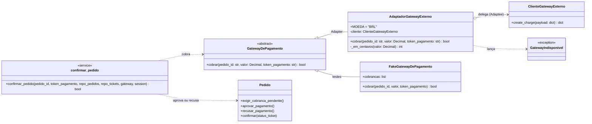

# Padrões GoF no RocketTicket

## Lucas — State

### Nome e categoria

<!--
Responsável: Lucas
O enunciado exige: o nome do padrão e a sua categoria no GoF.
-->

### Contexto e problema

<!--
Responsável: Lucas
O enunciado exige: o contexto e o problema real do domínio que o padrão resolve.
-->

### Alternativa considerada

<!--
Responsável: Lucas
O enunciado exige: a alternativa considerada.
-->

### Participantes (classes reais)

<!--
Responsável: Lucas
O enunciado exige: os participantes do padrão, mapeados para as classes reais do código.
-->

### Diagrama de classes (Mermaid)

<!--
Responsável: Lucas
O enunciado exige: o diagrama de classes em Mermaid, com a fonte em texto neste arquivo.
-->

### Teste

<!--
Responsável: Lucas
O enunciado exige: o teste que cobre o padrão.
-->

### Custo

<!--
Responsável: Lucas
O enunciado exige: o custo de introduzir o padrão.
-->

## Caio — Decorator

### Nome e categoria

<!--
Responsável: Caio
O enunciado exige: o nome do padrão e a sua categoria no GoF.
-->

### Contexto e problema

<!--
Responsável: Caio
O enunciado exige: o contexto e o problema real do domínio que o padrão resolve.
-->

### Alternativa considerada

<!--
Responsável: Caio
O enunciado exige: a alternativa considerada.
-->

### Participantes (classes reais)

<!--
Responsável: Caio
O enunciado exige: os participantes do padrão, mapeados para as classes reais do código.
-->

### Diagrama de classes (Mermaid)

<!--
Responsável: Caio
O enunciado exige: o diagrama de classes em Mermaid, com a fonte em texto neste arquivo.
-->

### Teste

<!--
Responsável: Caio
O enunciado exige: o teste que cobre o padrão.
-->

### Custo

<!--
Responsável: Caio
O enunciado exige: o custo de introduzir o padrão.
-->

## Igor — a definir

### Nome e categoria

<!--
Responsável: Igor
O enunciado exige: o nome do padrão e a sua categoria no GoF.
-->

### Contexto e problema

<!--
Responsável: Igor
O enunciado exige: o contexto e o problema real do domínio que o padrão resolve.
-->

### Alternativa considerada

<!--
Responsável: Igor
O enunciado exige: a alternativa considerada.
-->

### Participantes (classes reais)

<!--
Responsável: Igor
O enunciado exige: os participantes do padrão, mapeados para as classes reais do código.
-->

### Diagrama de classes (Mermaid)

<!--
Responsável: Igor
O enunciado exige: o diagrama de classes em Mermaid, com a fonte em texto neste arquivo.
-->

### Teste

<!--
Responsável: Igor
O enunciado exige: o teste que cobre o padrão.
-->

### Custo

<!--
Responsável: Igor
O enunciado exige: o custo de introduzir o padrão.
-->

## Miguel — Observer

### Nome e categoria

<!--
Responsável: Miguel
O enunciado exige: o nome do padrão e a sua categoria no GoF.
-->

### Contexto e problema

<!--
Responsável: Miguel
O enunciado exige: o contexto e o problema real do domínio que o padrão resolve.
-->

### Alternativa considerada

<!--
Responsável: Miguel
O enunciado exige: a alternativa considerada.
-->

### Participantes (classes reais)

<!--
Responsável: Miguel
O enunciado exige: os participantes do padrão, mapeados para as classes reais do código.
-->

### Diagrama de classes (Mermaid)

<!--
Responsável: Miguel
O enunciado exige: o diagrama de classes em Mermaid, com a fonte em texto neste arquivo.
-->

### Teste

<!--
Responsável: Miguel
O enunciado exige: o teste que cobre o padrão.
-->

### Custo

<!--
Responsável: Miguel
O enunciado exige: o custo de introduzir o padrão.
-->

## Guilherme — Adapter

### Nome e categoria

<!--
Responsável: Guilherme
O enunciado exige: o nome do padrão e a sua categoria no GoF.
-->

**Adapter**, padrão **estrutural** do GoF, na variante de objeto (por composição). Ele
converte a interface de uma classe em outra que o cliente espera, permitindo que classes
com interfaces incompatíveis trabalhem juntas.

### Contexto e problema

<!--
Responsável: Guilherme
O enunciado exige: o contexto e o problema real do domínio que o padrão resolve.
-->

Um pedido só pode ser confirmado com o pagamento aprovado (ADR 0005). Até a entrega da
Fase 1, ninguém cobrava de fato: a rota `POST /pedidos/<id>/confirmacao` recebia
`pagamento_aprovado: true/false` no JSON, e o `confirmar_pedido` aprovava ou recusava o
pagamento conforme esse booleano. Na prática, era o próprio comprador que dizia se tinha
pago.

O passo natural é cobrar o pedido em um gateway de pagamento externo. Nesta entrega, esse
gateway é simulado por `ClienteGatewayExterno` (`adapters/gateway_simulado.py`), que faz o
papel do SDK de um fornecedor: código de terceiros que o RocketTicket não pode alterar. A
interface dele não combina com a do domínio:

| O que o domínio tem | O que o gateway externo espera ou devolve |
| :--- | :--- |
| `valor: Decimal` em reais (`105.00`) | `"amount_cents": int` em centavos (`10500`) |
| `pedido_id`, `token_pagamento` | dicionário com `"order_ref"`, `"card_token"` e `"currency": "BRL"` |
| pagamento aprovado ou recusado | `{"status": "approved" \| "declined" \| "error", "reason": ...}` |
| falha é exceção | falha volta como `"status": "error"`, sem exceção |

Sem um adaptador, essas conversões entrariam no `confirmar_pedido`: o service passaria a
conhecer centavos, chaves em inglês e os textos de status do fornecedor. Trocar de
fornecedor, ou usar um gateway falso nos testes, exigiria editar o caso de uso.

### Alternativa considerada

<!--
Responsável: Guilherme
O enunciado exige: a alternativa considerada.
-->

1. **Chamar o `ClienteGatewayExterno` direto no `confirmar_pedido`.** É menos código, mas
   amarra o caso de uso ao formato de um fornecedor. A conversão de `Decimal` para
   centavos e o mapeamento de `"approved"`/`"declined"`/`"error"` ficariam misturados à
   regra do pedido, e os testes unitários do service precisariam montar respostas no
   formato do fornecedor. Rejeitada.
2. **Adapter de classe (herdar de `GatewayDePagamento` e de `ClienteGatewayExterno` ao
   mesmo tempo).** Python permite herança múltipla, mas o adaptador passaria a expor
   `create_charge()` ao service e ficaria preso a uma única classe de cliente. A versão
   de objeto recebe o cliente no construtor, o que deixa trocar o cliente (inclusive por
   um espião, nos testes) sem criar subclasses. Rejeitada em favor do adapter de objeto.
3. **Manter o booleano `pagamento_aprovado` vindo do JSON.** Não resolve o problema: o
   cliente HTTP continuaria decidindo se o pagamento foi aprovado.

### Participantes (classes reais)

<!--
Responsável: Guilherme
O enunciado exige: os participantes do padrão, mapeados para as classes reais do código.
-->

| Papel no GoF | Classe real | Arquivo |
| :--- | :--- | :--- |
| **Target** | `GatewayDePagamento` (`cobrar(pedido_id, valor, token_pagamento) -> bool`) | `src/rocketicket/adapters/pagamento.py` |
| **Adapter** | `AdaptadorGatewayExterno` | `src/rocketicket/adapters/pagamento.py` |
| **Adaptee** | `ClienteGatewayExterno` (`create_charge(payload: dict) -> dict`) | `src/rocketicket/adapters/gateway_simulado.py` |
| **Client** | `services.confirmar_pedido` | `src/rocketicket/service_layer/services.py` |

O `AdaptadorGatewayExterno` traduz nos dois sentidos:

- **Na ida:** converte `Decimal` em centavos inteiros sem arredondar (fração de centavo
  lança `ValueError` antes de chamar o fornecedor) e monta o payload com `amount_cents`,
  `currency`, `order_ref` e `card_token`.
- **Na volta:** `"approved"` vira `True` e `"declined"` vira `False`. `"error"`, ou
  qualquer resposta fora do contrato, vira a exceção `GatewayIndisponivel`, que a API
  devolve como `502`.

A composição fica no `create_app()`, que por padrão monta
`AdaptadorGatewayExterno(ClienteGatewayExterno())` e aceita outro `GatewayDePagamento` pelo
parâmetro `gateway_de_pagamento`. Nos testes, o `FakeGatewayDePagamento` (`tests/conftest.py`)
implementa o mesmo Target sem passar pelo Adaptee.

Para a simulação, o `ClienteGatewayExterno` decide pelo token, como os ambientes de teste
dos gateways reais: `tok_aprovado` aprova, `tok_recusado` recusa, `tok_falha` devolve
erro e qualquer outro token é recusado.

### Diagrama de classes (Mermaid)

<!--
Responsável: Guilherme
O enunciado exige: o diagrama de classes em Mermaid, com a fonte em texto neste arquivo.
-->

### Teste

<!--
Responsável: Guilherme
O enunciado exige: o teste que cobre o padrão.
-->

- **`tests/unit/test_gateway_pagamento.py`** cobre o Adapter isolado. Com um
  `ClienteEspiao` no lugar do Adaptee, verifica o payload montado, a conversão para
  centavos (`0.01 -> 1`, `110.5 -> 11050`, `1000 -> 100000`), a recusa de fração de
  centavo sem chamar o fornecedor e a tradução de `approved`, `declined`, `error` e de
  respostas fora do contrato. Com o `ClienteGatewayExterno` de verdade, cobre os quatro
  tipos de token e o valor zero.
- **`tests/unit/test_services_pedido.py::TestConfirmarPedido`** usa o
  `FakeGatewayDePagamento` e verifica que o service cobra o valor do pedido com o token
  recebido. Verifica também que **não** cobra quando o pedido não existe, o ticket não
  existe, o pedido já foi confirmado ou cancelado, ou o pagamento já foi recusado. Se o
  gateway falhar, nada é salvo e o pagamento continua `PENDENTE`.
- **`tests/unit/test_pedido.py::TestExigirCobrancaPendente`** cobre a nova checagem do
  agregado.
- **`tests/e2e/test_pedido_api.py`** passa pela API com o adaptador e o gateway simulado
  reais. Aprovação, recusa e token desconhecido devolvem `200`. Falha do gateway devolve
  `502` e deixa tentar de novo. Token ausente ou inválido devolve `400`. Há também um teste
  que injeta um gateway pelo `create_app()`.

A suíte foi de 296 para 326 testes, todos passando com `python -m pytest tests`.

### Custo

<!--
Responsável: Guilherme
O enunciado exige: o custo de introduzir o padrão.
-->

- **Código novo:** dois módulos (`pagamento.py`, 68 linhas, e `gateway_simulado.py`, 49
  linhas) e uma exceção a mais (`GatewayIndisponivel`), tratada em `erros.py`. Para uma
  única chamada ao fornecedor, é uma camada a mais para ler.
- **Mudança de contrato da API:** a confirmação passou de `{"pagamento_aprovado": bool}`
  para `{"token_pagamento": "..."}`. Quem chamava a rota antiga precisa mudar. Na suíte, isso
  alterou os testes e2e do Pedido e uma linha do teste de injeção do Caio
  (`tests/integration/test_ticket_repository_injection.py`), que passa pela confirmação.
- **Checagem nova no domínio:** como a cobrança acontece fora do sistema, antes de
  `aprovar_pagamento()`, o Pedido ganhou `exigir_cobranca_pendente()`. Sem ela, um pedido
  já confirmado seria cobrado de novo antes de o domínio recusar a operação.
- **Limitação conhecida:** a disponibilidade do ticket só é checada pelas regras de
  confirmação, depois da cobrança. Se o ticket deixar de estar `ANUNCIADO`, o gateway
  aprova, o Pedido lança `TicketIndisponivel` e nada é salvo, mas o comprador foi cobrado.
  Com um fornecedor real, isso exigiria pré-autorização e captura, ou estorno. O id da
  cobrança (`charge_id`) também não é persistido, porque o Pagamento ainda não tem esse
  campo (ADR 0005).

Compensa porque o caso de uso fala só a língua do domínio (`cobrar(...) -> bool`). Trocar
de fornecedor é escrever outro adaptador e passá-lo ao `create_app()`, sem tocar no
`confirmar_pedido`. Os testes do service também não dependem do formato de nenhum gateway.
